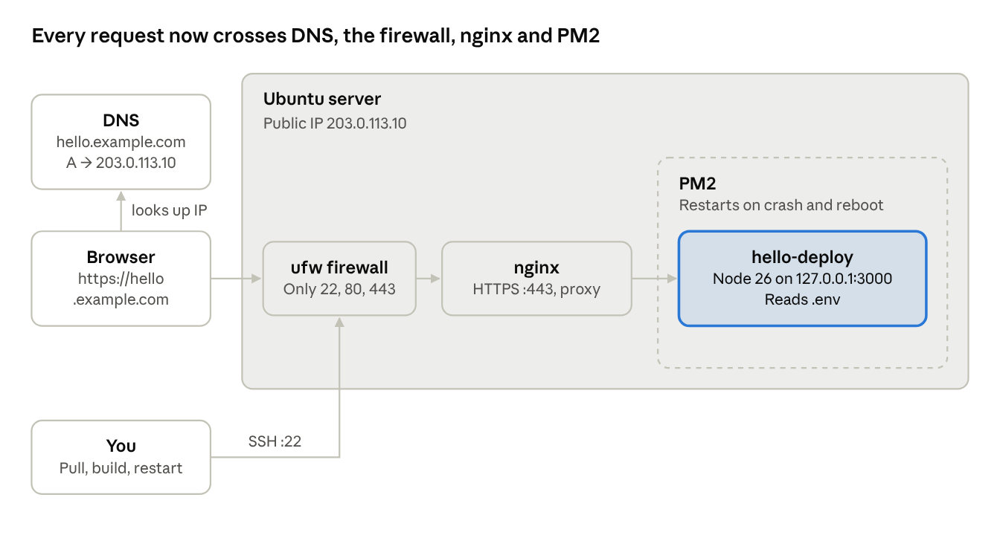

# Shipping It, Part 1: From localhost to a real domain

## About this series

**Shipping It** follows one small app from a single hand-built server to the kind of deployment system large engineering teams run. We climb one step at a time, and only when the current setup starts to hurt.

| Stage | Team size | What we add |
| --- | --- | --- |
| Solo, one server | 1 engineer | A public server, process manager, reverse proxy, domain and HTTPS; then scripted deploys, rollback and containers |
| Small team | 2 to 8 engineers | CI/CD, staging and production environments, secrets, safe database migrations |
| Scaling the system | Several teams | Load balancers, infrastructure as code, orchestration, microservices |
| Release engineering | Many services | Observability, release sets, rollback strategies, feature flags, A/B testing, canary releases |
| Enterprise | Many teams and regions | GitOps, platform engineering, multi-region rollouts, autonomous deployment |

Every part follows the same shape:

- It **starts from a pain** the previous part left behind, so you feel the problem before you see the fix.
- It **fixes that pain with the simplest tool that works**, using real commands you can run on a real server.
- It **ends with a standards check**: which industry practices (the Twelve-Factor App, CIS Benchmarks and others) the setup now follows, and which it still breaks.

**Who it is for:** developers who can build an app but have never shipped one, and engineers who use CI/CD and Kubernetes every day but want to know why each piece exists. Stop at whichever stage fits your team; you will know exactly what you are trading off.

---

## Part 1: From localhost to a real domain

Every deployment system, from a weekend project to Netflix, starts with the same question: how do I let other people use the thing running on my computer? In this first part we answer it the simplest way possible. One app, one server, a real domain and HTTPS. No Docker, no CI, no magic.

Along the way, watch for the **Pain now** notes. Each one is a problem the current setup cannot solve, and each one is the reason the next step exists.

## The problem: localhost only works for you

When you run an app on your laptop, it listens on something like `http://localhost:3000`. Open that in your browser and it works. Send the same link to a friend and it fails.

That is because `localhost` always means *this machine*. On your friend's laptop, `localhost` points to their own computer, where your app is not running.

To be reachable, your app needs an address that the whole internet can route to: a **public IP address**. Your laptop usually does not have one. At home it sits behind your router (and often behind your ISP's network too), so incoming connections from the internet never reach it.

## The demo application

The app is not the focus of this series. Serving it to anyone is. So we use a tiny TypeScript API with three routes:

| Route | What it does |
| --- | --- |
| `/` | A simple HTML page showing which server answered |
| `/health` | JSON status, used to check the app is alive |
| `/crash` | Kills the process on purpose, so we can test auto-restart later |

```
hello-deploy/
├── src/
│   └── server.ts
├── .env.example
├── .gitignore
├── package.json
└── tsconfig.json
```

**src/server.ts**

```typescript
import express from "express";
import os from "node:os";

const app = express();

// Configuration comes from environment variables, never from the code.
const PORT = Number(process.env.PORT ?? 3000);
const HOST = process.env.HOST ?? "0.0.0.0";
const APP_NAME = process.env.APP_NAME ?? "hello-deploy";
const startedAt = new Date();

// A human-friendly page, so you can see it in a browser.
app.get("/", (_req, res) => {
  res.send(`
    <h1>Hello from ${APP_NAME}</h1>
    <p>Served by <b>${os.hostname()}</b></p>
    <p>Running since ${startedAt.toISOString()}</p>
  `);
});

// A health endpoint for you, your scripts and (later) your load balancer.
app.get("/health", (_req, res) => {
  res.json({
    status: "ok",
    app: APP_NAME,
    host: os.hostname(),
    uptimeSeconds: Math.round(process.uptime()),
  });
});

// A deliberate crash, to prove the process manager restarts the app.
app.get("/crash", () => {
  console.error("Crashing on purpose");
  process.exit(1);
});

app.listen(PORT, HOST, () => {
  console.log(`${APP_NAME} listening on http://${HOST}:${PORT}`);
});
```

**package.json**

```json
{
  "name": "hello-deploy",
  "version": "1.0.0",
  "private": true,
  "type": "module",
  "main": "dist/server.js",
  "engines": { "node": ">=26" },
  "scripts": {
    "dev": "tsx watch --env-file=.env src/server.ts",
    "build": "tsc",
    "start": "node --env-file=.env dist/server.js"
  },
  "dependencies": {
    "express": "^5.3.0"
  },
  "devDependencies": {
    "@types/express": "^5.0.6",
    "@types/node": "^26.6.6",
    "tsx": "^4.23.15",
    "typescript": "^7.0.2"
  }
}
```

**tsconfig.json**

```json
{
  "compilerOptions": {
    "target": "ES2022",
    "module": "NodeNext",
    "moduleResolution": "NodeNext",
    "outDir": "dist",
    "rootDir": "src",
    "strict": true,
    "esModuleInterop": true,
    "skipLibCheck": true
  },
  "include": ["src"]
}
```

**.env.example**

```bash
# .env.example — copy to .env and fill in real values
APP_NAME=hello-deploy
PORT=3000
HOST=0.0.0.0
```

**.gitignore**

```
node_modules/
dist/
.env
```

Run it on your laptop first:

```bash
npm install
cp .env.example .env
npm run build
npm start
# hello-deploy listening on http://0.0.0.0:3000

curl http://localhost:3000/health
# {"status":"ok","app":"hello-deploy","host":"my-laptop","uptimeSeconds":3}
```

Push the project to a GitHub repository. We will pull it onto the server from there.

## Why not use your own machine?

You *can* serve the internet from your laptop. The easiest way is a **tunnel** (such as ngrok or Cloudflare Tunnel), which gives your local port a public URL. It is great for showing a demo to a client for ten minutes.

We will not do that here. A laptop sleeps, changes networks and shuts down when you close the lid. A real app needs a machine that is always on, always connected and has its own public IP.

## Step 1: Rent a server with a public IP

Any cloud provider works: DigitalOcean, AWS EC2 or Lightsail, Vultr, Hetzner, Linode. For a small app, **1 vCPU and 1 to 2 GB of RAM** is more than enough. Choose a current **Ubuntu LTS** image and add your SSH public key while creating it.

When it is ready, the provider shows its public IP. We will use `203.0.113.10` as an example; replace it with yours.

```bash
ssh root@203.0.113.10
```

Do not run your app as `root`. If the app is ever compromised, the attacker gets the whole server. Create a normal user once, then use it from now on:

```bash
adduser deploy
usermod -aG sudo deploy
rsync --archive --chown=deploy:deploy ~/.ssh /home/deploy
exit

ssh deploy@203.0.113.10
```

## Step 2: Get the code onto the server

There are two ways to do this, and the difference matters.

### Option A: Build locally, copy with scp

`scp` copies files from your machine to the server over SSH. You build on your laptop and upload the output:

```bash
# on your laptop
npm run build
scp -r dist package.json package-lock.json deploy@203.0.113.10:~/hello-deploy/

# on the server
cd ~/hello-deploy && npm ci --omit=dev
```

It works, until it does not. Your laptop and your server are different machines:

- **Different CPU architecture.** A MacBook is ARM; most servers are x86. Packages with native code (`bcrypt`, `sharp`, database drivers) compile for the machine they are installed on.
- **Different Node.js version.** Code built and tested on Node 26 can behave differently on an older Node 22 server.
- **Different OS libraries.** macOS and Ubuntu ship different system libraries.

The result is the classic bug: *it works on my machine* and breaks on the server.

### Option B: Build on the server (what we will do)

Building on the server means everything is compiled for the machine that runs it. The cost is that the server now needs the source code and the build tools.

Install Git and Node.js. We use nvm, so you can pin the exact Node version your app was developed with:

```bash
sudo apt update && sudo apt upgrade -y
sudo apt install -y git

curl -o- https://raw.githubusercontent.com/nvm-sh/nvm/master/install.sh | bash
source ~/.bashrc
nvm install 26
node --version
```

Clone the repository and build:

```bash
git clone https://github.com/yourname/hello-deploy.git
cd hello-deploy

npm ci          # installs exactly what package-lock.json says
npm run build   # compiles src/ into dist/
ls dist
# server.js
```

Two details worth knowing:

- Use `npm ci`, not `npm install`. It installs the exact versions from `package-lock.json`, the ones you tested. `npm install` may quietly pick newer ones.
- The build needs `typescript`, a dev dependency. Do not set `NODE_ENV=production` before `npm ci`, or npm skips dev dependencies and the build fails.

For a private repository, create a read-only **deploy key** on the server (`ssh-keygen -t ed25519`) and add its public key in the repository settings. It can pull code and nothing else.

## Step 3: Run it and open it to the world

Start the app:

```bash
npm start
# node: .env: not found
```

It fails, and that is a good lesson. `.env` is in `.gitignore`, so it never reached the server. Configuration and secrets do not travel with the code; each server needs its own copy.

Create it on the server and lock it down so only your user can read it:

```bash
cp .env.example .env
nano .env        # set real values; in a real app, DATABASE_URL, API keys and so on
chmod 600 .env

npm start
# hello-deploy listening on http://0.0.0.0:3000
```

One more door to open. Most servers block incoming traffic by default. Allow port 3000 in the server's firewall:

```bash
sudo ufw allow OpenSSH
sudo ufw allow 3000
sudo ufw enable
```

On AWS, Google Cloud or Azure there is a second firewall outside the server: the **security group** (or firewall rules). Add an inbound rule for TCP port 3000 there too, or traffic never reaches your machine.

Now open `http://203.0.113.10:3000` from your phone, or send it to a friend.

**Congratulations, you just deployed an application to the internet.** Anyone in the world can reach it.

> **Cannot reach it?** Check in this order: is the app running (`curl localhost:3000/health` on the server)? Is it listening on `0.0.0.0`, not `127.0.0.1`? Does `sudo ufw status` allow 3000? Does the cloud security group allow 3000?

## The first pain: it dies with your terminal

Try three things:

1. Close your SSH session. The app stops, because it was a child of your terminal.
2. Visit `/crash`. The process exits and nothing brings it back.
3. Run `sudo reboot`. When the server comes back up, nothing starts your app.

Each time, you have to SSH in and run `npm start` again by hand. Your users will find out before you do.

> **Pain now:** the app is only alive while you are watching it. We need something that starts it in the background, restarts it when it crashes, and starts it again after the server reboots.

That something is a **process manager**. On Linux you could use `systemd`, which is built in. For Node.js apps, the most popular choice is **PM2**, so we use it here.

## Step 4: Keep it alive with PM2

Stop the app with `Ctrl+C` and install PM2 globally:

```bash
npm install -g pm2
```

Start the app through PM2 instead of `npm start`. The `--node-args` flag passes `--env-file=.env` to Node, so the app still gets its configuration:

```bash
cd ~/hello-deploy
pm2 start dist/server.js --name hello-deploy --node-args="--env-file=.env"
```

PM2 now runs the app in the background. Close your SSH session and it keeps running. Test the crash case:

```bash
curl http://localhost:3000/crash   # the process exits
curl http://localhost:3000/health  # ...and PM2 has already restarted it
pm2 status
# │ hello-deploy │ fork │ ↺ 1 │ online │
```

The `↺` column counts restarts. A number that keeps growing means your app is crash-looping, which is worth investigating.

PM2 handles crashes, but not a server reboot yet. Two more commands fix that:

```bash
pm2 startup   # prints a command starting with sudo; copy it and run it
pm2 save      # saves the current app list, restored on every boot
```

Now test it the honest way: run `sudo reboot`, wait a minute, and open `http://203.0.113.10:3000` again. If it loads without you touching anything, your app survives both crashes and restarts.

Commands you will use every day:

| Command | What it does |
| --- | --- |
| `pm2 status` | Is it running, how many restarts, memory use |
| `pm2 logs hello-deploy` | Live logs (Ctrl+C to exit) |
| `pm2 restart hello-deploy` | Restart after deploying new code |
| `pm2 stop hello-deploy` | Stop it, but keep it in the list |
| `pm2 monit` | Live CPU and memory dashboard |

> **Pain now:** look at the link you are sharing: `http://203.0.113.10:3000`. Nobody types a port number. Worse, your Node process faces the internet directly. Every scanner, bot and malformed request hits your application code with nothing in between to filter, buffer or encrypt it.

## Step 5: Put nginx in front, on port 80

Browsers use port **80** for `http://` and port **443** for `https://` automatically. That is why you never type `:80`. So why not run Node on port 80 directly?

- Ports below 1024 need root privileges on Linux, and we just stopped running as root.
- Node is good at running your app logic. It is not the best tool for handling TLS certificates, slow clients, huge uploads, compression or thousands of idle connections.
- Later you will want several apps, or several copies of one app, behind the same IP.

The standard answer is a **reverse proxy**: a web server that accepts every public request and forwards it to your app. The most common one is **nginx**.

```
Browser ──▶ nginx :80 (public) ──▶ Node :3000 (private, 127.0.0.1)
```

Install it:

```bash
sudo apt install -y nginx
```

> **Where nginx configs live.** Older tutorials put sites in `sites-available` and symlink them into `sites-enabled`. That layout exists only in Debian and Ubuntu's own package; the official nginx.org packages have no such folders. Both packages load every file in `/etc/nginx/conf.d/*.conf`, so we put our config there: it works on either, with no symlink step.

Create a site config at `/etc/nginx/conf.d/hello-deploy.conf`:

```nginx
server {
    listen 80;
    server_name _;          # any hostname for now; we set the domain in step 6

    location / {
        proxy_pass http://127.0.0.1:3000;
        proxy_http_version 1.1;

        # Tell the app who the real client is
        proxy_set_header Host              $host;
        proxy_set_header X-Real-IP         $remote_addr;
        proxy_set_header X-Forwarded-For   $proxy_add_x_forwarded_for;
        proxy_set_header X-Forwarded-Proto $scheme;
    }
}
```

Remove the default site so it does not answer requests meant for your app, then test the config and reload:

```bash
# Ubuntu's package ships its default site here:
sudo rm -f /etc/nginx/sites-enabled/default
# the nginx.org package ships it here instead:
sudo rm -f /etc/nginx/conf.d/default.conf

sudo nginx -t                # always test before reloading
sudo systemctl reload nginx
```

Now close the side door. The app should only be reachable through nginx, so make it listen on the loopback address instead of every interface. In `.env`:

```bash
HOST=127.0.0.1
```

Restart the app and update the firewall: allow web traffic, remove port 3000:

```bash
pm2 restart hello-deploy --update-env

sudo ufw allow 'Nginx Full'   # ports 80 and 443
sudo ufw delete allow 3000
sudo ufw status
```

If you added port 3000 to a cloud security group, replace it with ports 80 and 443 there too.

Open `http://203.0.113.10` with no port. It works, and `http://203.0.113.10:3000` no longer does. Your app is now hidden behind nginx.

> **Pain now:** nobody remembers `203.0.113.10`. And if you ever rebuild or move the server, the IP changes and every link you have shared breaks.

## Step 6: Give it a real domain

A domain is a human-friendly name that points to your IP. The system that translates names to IPs is **DNS**, the internet's phone book. When someone opens `hello.example.com`, their browser asks DNS for the IP, then connects to it.

Buy a domain from any registrar (Namecheap, Cloudflare, Porkbun, GoDaddy). We will use `example.com`; replace it with yours.

### Add a DNS record

In your registrar's or DNS provider's dashboard, add an **A record**. An A record maps a name to an IPv4 address.

| Type | Name | Value | TTL |
| --- | --- | --- | --- |
| A | `hello` | `203.0.113.10` | 300 |

This makes `hello.example.com` point to your server. Use `@` as the name if you want the bare `example.com`.

**TTL** (time to live) is how many seconds other DNS servers may cache the answer. A short TTL like 300 (5 minutes) means changes spread quickly, which is what you want while setting things up.

> If you use Cloudflare for DNS, set the record to **DNS only** (grey cloud) for now. Its proxy mode is useful, but it changes how HTTPS works and gets in the way of the next step.

### Check that it resolves

DNS changes take from a few seconds to several minutes. Check from your laptop:

```bash
dig +short hello.example.com
# 203.0.113.10

# no dig? this works on every OS
nslookup hello.example.com
```

When it returns your server's IP, DNS is done.

### Tell nginx its name

Replace `server_name _;` in `/etc/nginx/conf.d/hello-deploy.conf` with your domain:

```nginx
server_name hello.example.com;
```

```bash
sudo nginx -t && sudo systemctl reload nginx
```

Open `http://hello.example.com`. Your app, on a real name.

The name also protects you from IP changes. If you move to a new server, you update one DNS record and every link keeps working.

> **Pain now:** the browser shows **Not secure** next to your domain. Everything travels as plain text, so anyone on the same café Wi-Fi, or anywhere along the route, can read passwords, cookies and API tokens. Modern browser features (secure cookies, HTTP/2, geolocation, service workers) also refuse to work without HTTPS.

## Step 7: Turn on HTTPS

HTTPS is HTTP inside an encrypted **TLS** connection. To set one up, your server needs a **certificate**: a file, signed by a trusted certificate authority, that proves *this server really is hello.example.com*. The browser checks that signature before it sends anything.

That is why the domain had to come first. A certificate is issued for a name, not for an IP, and the authority checks that you control the name before issuing it.

**Let's Encrypt** issues certificates for free, and **certbot** automates the whole process, including the nginx changes.

```bash
sudo apt install -y certbot python3-certbot-nginx
sudo certbot --nginx -d hello.example.com
```

Certbot asks for an email (for expiry warnings) and asks you to accept the terms. Then it:

1. Proves to Let's Encrypt that you control the domain, by serving a temporary file on port 80.
2. Downloads the certificate to `/etc/letsencrypt/live/hello.example.com/`.
3. Updates your nginx site to listen on 443 with that certificate.
4. Adds a redirect so `http://` sends visitors to `https://`.

Your nginx config now looks roughly like this (certbot wrote the parts marked `managed by Certbot`):

```nginx
server {
    server_name hello.example.com;

    location / {
        proxy_pass http://127.0.0.1:3000;
        proxy_http_version 1.1;
        proxy_set_header Host              $host;
        proxy_set_header X-Real-IP         $remote_addr;
        proxy_set_header X-Forwarded-For   $proxy_add_x_forwarded_for;
        proxy_set_header X-Forwarded-Proto $scheme;
    }

    listen 443 ssl; # managed by Certbot
    ssl_certificate /etc/letsencrypt/live/hello.example.com/fullchain.pem; # managed by Certbot
    ssl_certificate_key /etc/letsencrypt/live/hello.example.com/privkey.pem; # managed by Certbot
    include /etc/letsencrypt/options-ssl-nginx.conf; # managed by Certbot
    ssl_dhparam /etc/letsencrypt/ssl-dhparams.pem; # managed by Certbot
}

server {
    listen 80;
    server_name hello.example.com;
    return 301 https://$host$request_uri; # managed by Certbot
}
```

Let's Encrypt certificates expire after a short period by design, so renewal must be automatic. Certbot installs a timer that renews them before they expire. Confirm the timer works:

```bash
sudo certbot renew --dry-run
systemctl list-timers | grep certbot
```

Check from your laptop:

```bash
curl -I http://hello.example.com
# HTTP/1.1 301 Moved Permanently
# Location: https://hello.example.com/

curl https://hello.example.com/health
# {"status":"ok","app":"hello-deploy","host":"hello-server","uptimeSeconds":842}
```

Open `https://hello.example.com` in a browser. The padlock is there. You now have a real, secure, always-on deployment.

## Step 8: Shipping an update

The first deploy is the hard one. After that, every release is the same routine. Change some code on your laptop, push it, then:

```bash
ssh deploy@203.0.113.10
cd ~/hello-deploy

git pull origin main
npm ci
npm run build
pm2 restart hello-deploy

curl https://hello.example.com/health
```

About a minute of work. For a side project with a few users, this is genuinely fine. But look closely at what happens during that minute.

> **Pain now: every deploy causes downtime.** `pm2 restart` kills the running process before the new one is ready. For a second or two nothing listens on port 3000, and nginx answers every request with `502 Bad Gateway`.

> **Pain now: you build on the live server.** `npm ci` deletes `node_modules` while the old process is still running from it, and `npm run build` overwrites `dist/` in place. If either fails halfway, production is left half old and half new.

> **Pain now: rolling back is slow.** If the new version is broken, you have to find the last good commit, check it out, reinstall, rebuild and restart. That is the same slow minute again, under pressure, while users see errors.

> **Pain now: it all lives in your head.** The steps exist only as commands you remember. Miss one, or let a teammate try it, and production breaks in a new way.

## What you built



A visitor's browser looks up your domain in DNS, connects to your server's IP, passes the firewall, and reaches nginx over HTTPS. nginx forwards the request to your Node app on a private port, and PM2 keeps that app alive. You still reach the same server over SSH to deploy, which is exactly what Part 2 starts to change.

## Standards check

Big companies do not invent their deployment rules from scratch; they follow well-known practices. Here is how our single server measures up after Part 1.

| Practice | Where it comes from | Status after Part 1 |
| --- | --- | --- |
| Config in the environment, not in code | The Twelve-Factor App | Following: `.env`, never committed |
| The app binds to a port; something else exposes it | The Twelve-Factor App | Following: Node on `127.0.0.1:3000`, nginx in front |
| Least privilege | CIS Benchmarks | Partly: non-root user and firewall; SSH password login still enabled |
| Encryption in transit | Industry baseline | Following: HTTPS with automatic renewal and redirect |
| Reproducible builds | The Twelve-Factor App (build, release, run) | Breaking: we build on the live server |
| Zero-downtime deploys and fast rollback | Continuous delivery practice | Breaking: every restart drops requests; rollback means rebuilding |
| Dev/prod parity | The Twelve-Factor App | Breaking: the server is set up by hand and will drift from your laptop |

Before anyone else depends on this server, finish hardening SSH and run through the checklist:

```bash
# /etc/ssh/sshd_config: keys only, no root login
PasswordAuthentication no
PermitRootLogin no

sudo systemctl restart ssh   # test a new SSH session before closing the old one
```

- [ ] SSH password and root login disabled
- [ ] App survives `/crash` and `sudo reboot`
- [ ] Port 3000 closed in both `ufw` and the cloud security group
- [ ] `sudo certbot renew --dry-run` passes
- [ ] `.env` has `chmod 600` and is not in Git
- [ ] The update steps are written down somewhere other than your head

## Next: Part 2, scripting the deploy

The deploy works, but it is a manual ritual with downtime and no undo. In Part 2 we fix all four pains from Step 8 without adding any new infrastructure:

- One command deploys from your laptop.
- Each release builds in its own timestamped folder, so the live app is never touched mid-build.
- An atomic symlink switch plus `pm2 reload` gives zero-downtime releases.
- Rolling back to the previous version takes one command and about a second.

Same server, same app, far less fear when you press deploy.
